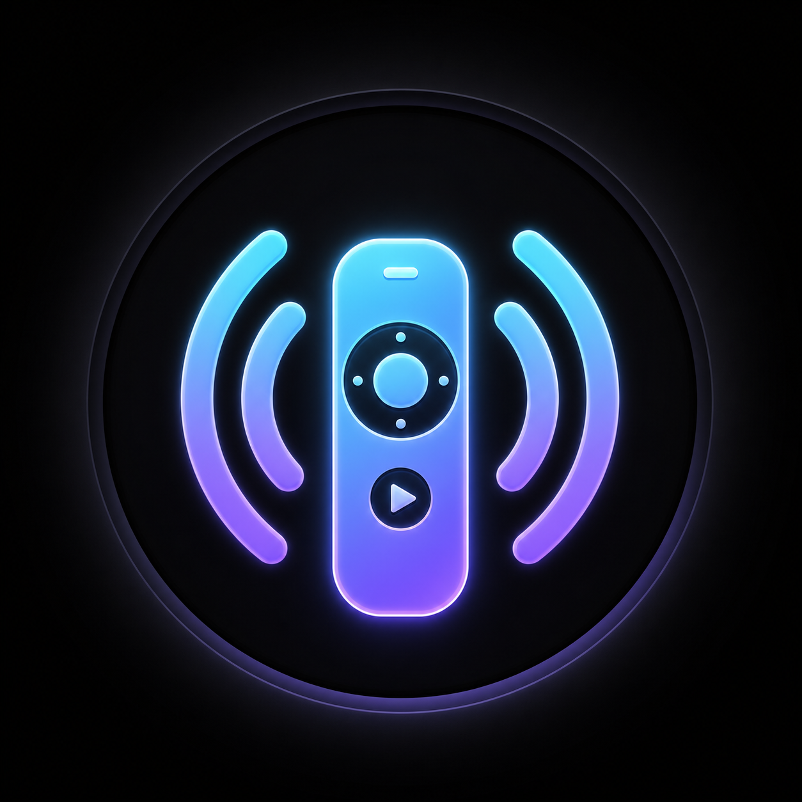
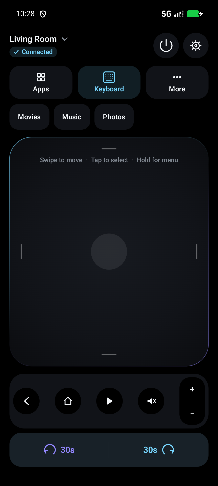
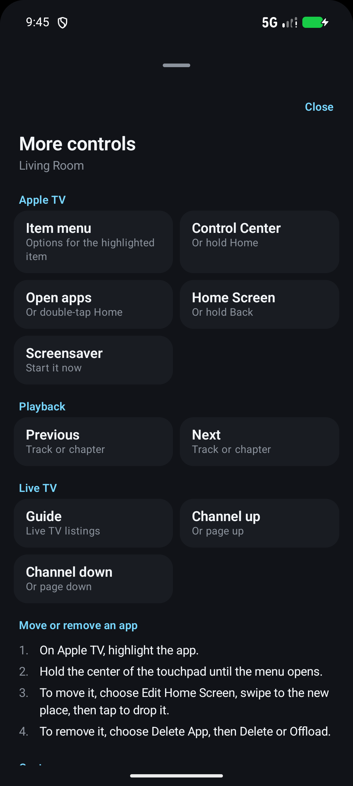
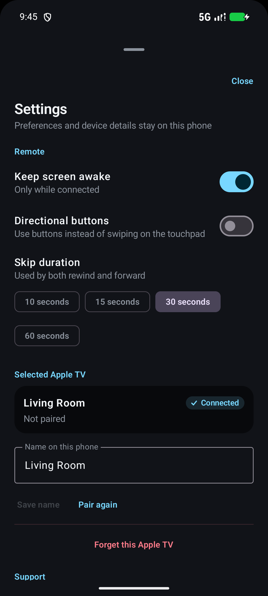

<p align="center">
  
</p>

<h1 align="center">Relay Remote</h1>
<p align="center">Your Android phone. Your Apple TV. One local connection.</p>
<p align="center">
  <a href="https://github.com/MAlshehri/RelayRemote/actions/workflows/android.yml"></a>
  
  <a href="LICENSE"></a>
</p>

Relay Remote is an open-source Android remote for Apple TV, built with Kotlin
and Jetpack Compose. Discover a TV on your Wi-Fi network, pair with the code
shown on its screen, and control it from a compact, dark interface.

No account, cloud service, ads, or analytics. Commands travel over your local
network using an encrypted Companion Link session.

> **Experimental release.** Pairing and saved-connection recovery have been
> exercised on hardware. Some controls, especially keyboard synchronization and
> playback seeking, still need broader real-device testing. See
> [verification status](docs/HARDWARE_TEST_REPORT.md) before relying on them.

## Screenshots

<p align="center">
  
  &nbsp;&nbsp;
  
  &nbsp;&nbsp;
  
</p>

Captured from the actual app UI on an Android emulator using fictional device
data. Available controls depend on the connected TV and active app.

## What you can do

- **Navigate:** swipe on the touchpad, with your finger's movement sent live, or
  turn on **Directional buttons** in Settings. Tap to select. Hold Back for the
  Home Screen, hold Home for Control Center, and double-tap Home for open apps.
- **Open item menus:** hold the center of the touchpad on a highlighted item. On
  the Home Screen, that menu is how you move, delete, or offload an app. **More**
  has the steps, plus a button for the same menu.
- **Control playback:** Play/Pause, plus a separate rewind/forward row with a
  configurable skip interval in Settings. Hold rewind or forward to scan when
  the app supports it.
- **Use extra TV controls:** Guide, Channel up and down, Screensaver, and
  switching between Apple TV profiles, all in **More**.
- **Manage devices:** pair, reconnect, rename, and forget saved Apple TVs.
- **Launch apps:** browse the TV's applications and pin favorites to the remote.
- **Open it quickly:** add the Home screen widget or the Quick Settings icon
  from **Settings > Quick access**.
- **Type from your phone:** use the keyboard when tvOS exposes a text field.
  Current-text loading, full-value updates, Clear, Reload, and retry handling
  are implemented; real-TV acceptance remains pending.
- **Adjust volume and power:** supported controls appear when the session
  advertises them. Mute saves the current volume and restores it when you unmute.
  Sleep asks you to confirm first.

## Get started

You need an **Android 16 (API 36) or newer** phone and an Apple TV reachable on
the same local network. Older Android versions are not supported by this build.
The recorded hardware baseline is Apple TV 4K (first generation), tvOS 18.6;
other combinations are not yet a verified compatibility matrix.

1. Build and install the APK using the instructions below, or download the
   `relay-remote-debug` artifact from a successful [Android workflow run](../../actions/workflows/android.yml)
   while signed in to GitHub. Workflow artifacts are development builds.
2. Open Relay Remote and tap the device selector at the top.
3. Choose your Apple TV and enter the four-digit code shown on the TV.
4. After pairing, the app stores an encrypted credential for later reconnection.
5. Open **Settings** to choose your playback skip interval.

## Build from source

Install Android Studio with **JDK 21**, Android SDK Platform **36**, and Android
SDK Build-Tools. The Gradle daemon is configured for Java 21; application source
targets Java 17. Dependencies require internet access on the first build.

```bash
git clone https://github.com/MAlshehri/RelayRemote.git
cd RelayRemote
```

Open the project in Android Studio and let it configure your SDK location, or
set `ANDROID_HOME` to your SDK directory. `local.properties` is machine-specific
and must stay untracked.

```bash
./gradlew :app:assembleDebug
adb install -r app/build/outputs/apk/debug/app-debug.apk
```

On Windows use `gradlew.bat`. The default build requires Android 16 on the
installation target; an older phone will reject the APK.

### Release builds

```bash
./gradlew :app:assembleRelease
```

This produces `app/build/outputs/apk/release/app-release-unsigned.apk`, with
optimization enabled and debugging disabled. Sign it with your own private key
using Android Studio's **Generate Signed App Bundle / APK**, or use the portable
helper described in [release signing](docs/RELEASE.md). No signing key is included.
Keep the same key for future updates; Android rejects updates signed by a
different key.

### Verification

```bash
./gradlew :app:testDebugUnitTest :protocol-appletv:testDebugUnitTest :app:lintDebug
ANDROID_SERIAL=emulator-5554 ./gradlew :app:connectedDebugAndroidTest
```

The second command requires a running Android 16 emulator. Automated checks cover
protocol codecs, cryptography, pairing, credential storage, reconnection, state
races, and Compose interactions. They do not prove every command's effect on a
physical TV. The [keyboard acceptance matrix](docs/KEYBOARD_INTERACTION_MATRIX.md)
tracks the remaining hardware checks.

## Troubleshooting and limitations

| Symptom | What to check |
| --- | --- |
| No TV appears | Keep both devices on the same LAN. Guest Wi-Fi, client isolation, VPNs, or blocked multicast can prevent discovery. Wake the Apple TV and refresh discovery. |
| Pairing fails | Use the current code shown on the TV and keep the TV reachable. Retry pairing after checking the connection. |
| A control is disabled | The connected session must advertise support. Keyboard also needs an active tvOS text field. |
| Skip or volume has no effect | Behavior depends on the TV, foreground app, and audio setup. These combinations still need hardware validation. |
| Keyboard cannot load text | Focus a field on the TV, then reopen or reload Keyboard. Protected fields may not expose their contents. |
| Done does not submit a TV search | Done closes the phone keyboard; it intentionally does not press a highlighted TV keyboard key. |

Now Playing metadata is currently disabled. Siri, Subtitles, and InSight are not
available because the protocol reference does not document their commands. There
is no media streaming, microphone access, or direct television-vendor integration. Volume
and TV power may depend on your Apple TV and HDMI-CEC setup. tvOS protocol
changes can affect compatibility.

## Privacy and security

Pairing credentials are encrypted with AES-256-GCM using a non-exportable Android
Keystore key. Android backup is disabled. PINs, keys, and entered keyboard text
are not logged by the app. Closing Keyboard clears its UI text; discovery and
the active session stop when the app backgrounds.

This project has not undergone an independent security audit. Please use
[private vulnerability reporting](SECURITY.md) for security issues and remove
personal data from all public bug reports.

## Project structure

| Path | Responsibility |
| --- | --- |
| `app/` | Compose interface, Android lifecycle, DNS-SD discovery, DataStore, Keystore |
| `protocol-appletv/` | Companion transport, OPACK/TLV8, pairing, encryption, command queues, RTI keyboard |
| `docs/` | Protocol references, verification status, screenshots, release instructions |

Protocol research references are documented in [Protocol reference](docs/PROTOCOL_REFERENCE.md).
See [Contributing](CONTRIBUTING.md) for development and bug-report guidance.

## License and credits

Released under the [MIT License](LICENSE). See [third-party notices](THIRD_PARTY_NOTICES.md)
for dependencies and protocol reference credits, including pyatv.

Relay Remote is an independent project and is not affiliated with or endorsed
by Apple. Apple TV is a trademark of Apple Inc.
